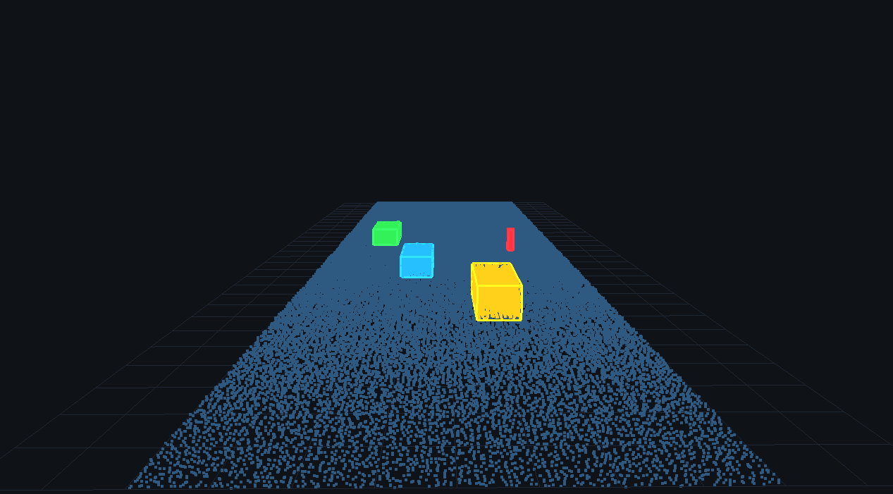

# 3D LiDAR & Point Cloud Processor (C++20)

 A high-performance, real-time 3D LiDAR perception and point cloud segmentation pipeline written in modern C++20 and Eigen3, featuring an interactive OpenGL/GLFW visualizer.

 

## Overview

 Designed for autonomous robotics and vehicle perception stacks, this processing pipeline converts raw, unorganized 3D point cloud measurements into classified obstacles and actionable 3D bounding boxes in sub-50 ms real-time cycles.

### Pipeline Architecture

```text
 Raw LiDAR Stream (100k pts)
          │
          ▼
 [Voxel Grid Downsampling]   ──> Uniform spatial density, 55% data reduction (~3 ms)
          │
          ▼
 [RANSAC Ground Detection]   ──> Separates drivable road surface from obstacles (~30 ms)
          │
          ▼
 [Spatial Hashing / DBSCAN]  ──> Euclidean clustering & 3D oriented bounding boxes (~10 ms)
          │
          ▼
 [Interactive 3D Viewer]     ──> Real-time OpenGL orbit visualizer with sensor grid
```

## Features

 - Modern C++20 Standard: Leverages structured bindings, concepts, and SIMD-aligned vector primitives (alignas(16)).
 - Voxel Centroid Downsampling: Hash-map spatial indexing reduces sensor load without loss of geometric features.
 - RANSAC Ground Plane Estimation: Computes the mathematical ground plane normal equation (Ax + By + Cz + D = 0) and strips the drivable corridor.
 - Euclidean Cluster Extraction: Spatial grid-based flood-fill clustering ($O(N)$ lookup) to identify separate traffic obstacles (vehicles, pedestrians, posts).
 - Interactive 3D OpenGL Viewer:
   - Orbit camera: Left-click and drag to rotate, scroll wheel to zoom.
   - Distinct color-coding per detected obstacle.
   - 3D wireframe bounding boxes and spatial ground grid.

## Building & Running

 Requirements:
  - CMake (>= 3.20)
  - Clang / GCC supporting C++20
  - Eigen3, GLFW, OpenGL

 Install dependencies via Homebrew (macOS):

 ```bash
 brew install cmake eigen glfw
 ```

 Build

 ```bash
 mkdir -p build && cd build
 cmake -DCMAKE_BUILD_TYPE=Release ..
 cmake --build .
 ```

 Run Processor & Viewer

 ```bash
 ./lidar_processor
 ```

 Run Test Suite

 ```bash
 ./run_tests
# or via CTest:
ctest --output-on-failure
```